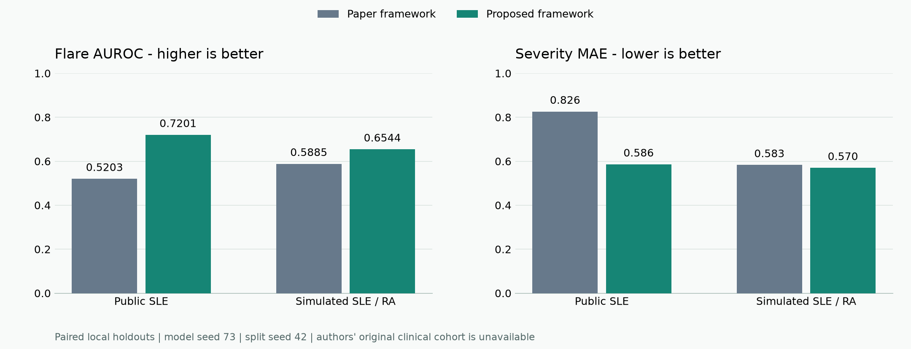

# Measured results: Paper framework versus Proposed framework

Generated from hash-verified completed runs. Normal preparation refreshes this file and [the JSON snapshot](results/current_comparison.json); do not edit performance numbers manually.

Source preparation: **25 Oct 2026, 19:15 IST**. Model seed **73**, patient / dataset split seed **42**, maximum neural epochs **30**.

These are paired local evaluations. The paper publication reports AUROC 0.867, AUPRC 0.726, F1 0.702, severity MAE 0.74, RMSE 0.95 and ECE 0.032 on its separate clinical cohort (supplied PDF, Tables 2-3 and IV.F, pages 14-15). Those values are historical references, not an additional model row or an evaluation on our test patients.

## Main-cohort AUROC improvement

| Cohort | Paper framework | Proposed framework | Absolute change |
|---|---:|---:|---:|
| Public pediatric SLE cohort, GSE65391 | 0.5203 | 0.7201 | +19.98 percentage points |
| Simulated SLE / RA cohort | 0.5885 | 0.6544 | +6.59 percentage points |

`AUROC points = (Proposed AUROC - Paper AUROC) * 100`. A four-point gain means +0.04 AUROC; it does not mean a 4% relative gain. Cohorts are not pooled.

## Public pediatric SLE cohort, GSE65391

157 total patients, 923 visits, 29 inputs; patient split **109 / 24 / 24** (train / validation / test). Held-out scoring uses **85 visit targets**, including **13 flares (15.3%)**. The chosen neural training ran 30 epochs.

| Metric | Better | Paper framework | Proposed framework | Proposed minus Paper |
|---|---|---:|---:|---:|
| AUROC | Higher | 0.5203 | 0.7201 | +0.1998 |
| AUPRC | Higher | 0.1744 | 0.3637 | +0.1893 |
| F1 | Higher | 0.2817 | 0.3438 | +0.0621 |
| Severity MAE | Lower | 0.8260 | 0.5860 | -0.2400 |
| Severity RMSE | Lower | 0.9520 | 0.7220 | -0.2300 |
| Brier | Lower | 0.1307 | 0.1230 | -0.0077 |
| ECE | Lower | 0.0208 | 0.0247 | +0.0039 |

Approximate severity-MAE reduction: **+29.06%**, calculated from the reported rounded scores.

**Trade-offs:** ECE worsened in this run.

Paired patient-bootstrap 95% interval for AUROC change: **[-0.55, +41.25] percentage points**, from 499 valid draws of 500 requested.
The interval includes zero, so this holdout does not establish a reliable positive AUROC change.

Saved validation thresholds: Paper **0.150**, Proposed **0.150**. Test outcomes did not choose these values.

| Selected correction detail | Flare head | Severity head |
|---|---:|---:|
| Strength | 0.75 | 1.0 |
| Trees | 73 | 49 |
| Internal configuration ID (0-based) | 2 | 2 |

Run ID: `34b8bcc5bf20-tmpvf7xe`. Its report and prediction hashes are recorded in the JSON snapshot.

## Simulated SLE / RA cohort

2,000 total patients, 33,253 visits, 52 inputs; patient split **1400 / 300 / 300** (train / validation / test). Held-out scoring uses **4,707 visit targets**, including **845 flares (18.0%)**. The chosen neural training ran 30 epochs.

| Metric | Better | Paper framework | Proposed framework | Proposed minus Paper |
|---|---|---:|---:|---:|
| AUROC | Higher | 0.5885 | 0.6544 | +0.0659 |
| AUPRC | Higher | 0.2234 | 0.2847 | +0.0613 |
| F1 | Higher | 0.3268 | 0.3574 | +0.0306 |
| Severity MAE | Lower | 0.5830 | 0.5700 | -0.0130 |
| Severity RMSE | Lower | 0.7430 | 0.7340 | -0.0090 |
| Brier | Lower | 0.1452 | 0.1409 | -0.0043 |
| ECE | Lower | 0.0041 | 0.0084 | +0.0043 |

Approximate severity-MAE reduction: **+2.23%**, calculated from the reported rounded scores.

**Trade-offs:** ECE worsened in this run.

Paired patient-bootstrap 95% interval for AUROC change: **[+4.69, +8.51] percentage points**, from 500 valid draws of 500 requested.
This interval excludes zero conditional on the fitted models and this evaluation cohort; it is not external clinical confirmation.

Saved validation thresholds: Paper **0.150**, Proposed **0.200**. Test outcomes did not choose these values.

| Selected correction detail | Flare head | Severity head |
|---|---:|---:|
| Strength | 1.0 | 1.0 |
| Trees | 227 | 300 |
| Internal configuration ID (0-based) | 1 | 1 |

Run ID: `622e2ab854dc-ufcw0qo3`. Its report and prediction hashes are recorded in the JSON snapshot.

## Random cohort 1

120 total patients, 720 visits, 18 inputs; patient split **72 / 24 / 24** (train / validation / test). Held-out scoring uses **120 visit targets**, including **22 flares (18.3%)**. The chosen neural training ran 30 epochs.

| Metric | Better | Paper framework | Proposed framework | Proposed minus Paper |
|---|---|---:|---:|---:|
| AUROC | Higher | 0.6048 | 0.6591 | +0.0543 |
| AUPRC | Higher | 0.2496 | 0.2921 | +0.0425 |
| F1 | Higher | 0.3099 | 0.3871 | +0.0772 |
| Severity MAE | Lower | 0.5860 | 0.5720 | -0.0140 |
| Severity RMSE | Lower | 0.7500 | 0.7050 | -0.0450 |
| Brier | Lower | 0.1576 | 0.1465 | -0.0111 |
| ECE | Lower | 0.0922 | 0.0521 | -0.0401 |

Approximate severity-MAE reduction: **+2.39%**, calculated from the reported rounded scores.

None of the listed rounded metrics worsened in this run; that does not guarantee future gains.

Paired patient-bootstrap 95% interval for AUROC change: **[-12.58, +24.43] percentage points**, from 500 valid draws of 500 requested.
The interval includes zero, so this holdout does not establish a reliable positive AUROC change.

Saved validation thresholds: Paper **0.050**, Proposed **0.200**. Test outcomes did not choose these values.

| Selected correction detail | Flare head | Severity head |
|---|---:|---:|
| Strength | 1.0 | 0.25 |
| Trees | 29 | 93 |
| Internal configuration ID (0-based) | 0 | 1 |

Run ID: `f615a686de19-b6fmqy_e`. Its report and prediction hashes are recorded in the JSON snapshot.

## Random cohort 2

120 total patients, 720 visits, 18 inputs; patient split **72 / 24 / 24** (train / validation / test). Held-out scoring uses **120 visit targets**, including **31 flares (25.8%)**. The chosen neural training ran 30 epochs.

| Metric | Better | Paper framework | Proposed framework | Proposed minus Paper |
|---|---|---:|---:|---:|
| AUROC | Higher | 0.5430 | 0.5585 | +0.0155 |
| AUPRC | Higher | 0.3281 | 0.3806 | +0.0525 |
| F1 | Higher | 0.4000 | 0.3967 | -0.0033 |
| Severity MAE | Lower | 0.5780 | 0.5700 | -0.0080 |
| Severity RMSE | Lower | 0.7780 | 0.7540 | -0.0240 |
| Brier | Lower | 0.1974 | 0.1930 | -0.0044 |
| ECE | Lower | 0.0829 | 0.0624 | -0.0205 |

Approximate severity-MAE reduction: **+1.38%**, calculated from the reported rounded scores.

**Trade-offs:** F1 worsened in this run.

Paired patient-bootstrap 95% interval for AUROC change: **[-8.37, +13.59] percentage points**, from 500 valid draws of 500 requested.
The interval includes zero, so this holdout does not establish a reliable positive AUROC change.

Saved validation thresholds: Paper **0.150**, Proposed **0.150**. Test outcomes did not choose these values.

| Selected correction detail | Flare head | Severity head |
|---|---:|---:|
| Strength | 1.0 | 0.25 |
| Trees | 40 | 51 |
| Internal configuration ID (0-based) | 0 | 1 |

Run ID: `75351ec4a0b8-nqhh4qxp`. Its report and prediction hashes are recorded in the JSON snapshot.

## Random cohort 3

120 total patients, 720 visits, 18 inputs; patient split **72 / 24 / 24** (train / validation / test). Held-out scoring uses **120 visit targets**, including **30 flares (25.0%)**. The chosen neural training ran 30 epochs.

| Metric | Better | Paper framework | Proposed framework | Proposed minus Paper |
|---|---|---:|---:|---:|
| AUROC | Higher | 0.4937 | 0.5470 | +0.0533 |
| AUPRC | Higher | 0.2494 | 0.2732 | +0.0238 |
| F1 | Higher | 0.4160 | 0.4098 | -0.0062 |
| Severity MAE | Lower | 0.5040 | 0.4960 | -0.0080 |
| Severity RMSE | Lower | 0.6920 | 0.6770 | -0.0150 |
| Brier | Lower | 0.1935 | 0.1909 | -0.0026 |
| ECE | Lower | 0.0751 | 0.0484 | -0.0267 |

Approximate severity-MAE reduction: **+1.59%**, calculated from the reported rounded scores.

**Trade-offs:** F1 worsened in this run.

Paired patient-bootstrap 95% interval for AUROC change: **[-1.71, +14.52] percentage points**, from 500 valid draws of 500 requested.
The interval includes zero, so this holdout does not establish a reliable positive AUROC change.

Saved validation thresholds: Paper **0.125**, Proposed **0.150**. Test outcomes did not choose these values.

| Selected correction detail | Flare head | Severity head |
|---|---:|---:|
| Strength | 1.0 | 0.25 |
| Trees | 43 | 44 |
| Internal configuration ID (0-based) | 0 | 1 |

Run ID: `fb35ca376537-04y8fej8`. Its report and prediction hashes are recorded in the JSON snapshot.

## What this means

The observed gains compare Proposed against the shared local Paper backbone. They do not establish superiority on the publication's unavailable cohort or guarantee a 4-5-point gain on every new dataset. Random cohorts are controlled simulations, not independent clinical replications.

The bootstrap resamples held-out patients for fixed models. It excludes training, tuning and population uncertainty. Validation is reused for early stopping, Platt scaling, head tuning, seed selection and thresholds; the frozen seed criterion favored Proposed validation AUROC. The holdout has been inspected during development. Independent / nested validation and a fresh clinical cohort remain necessary.

See [Methodology](METHODOLOGY.md), [Architecture](CAUSAL_MODEL.md) and [Audit](PROJECT_AUDIT.md) for the implementation and limitations.
