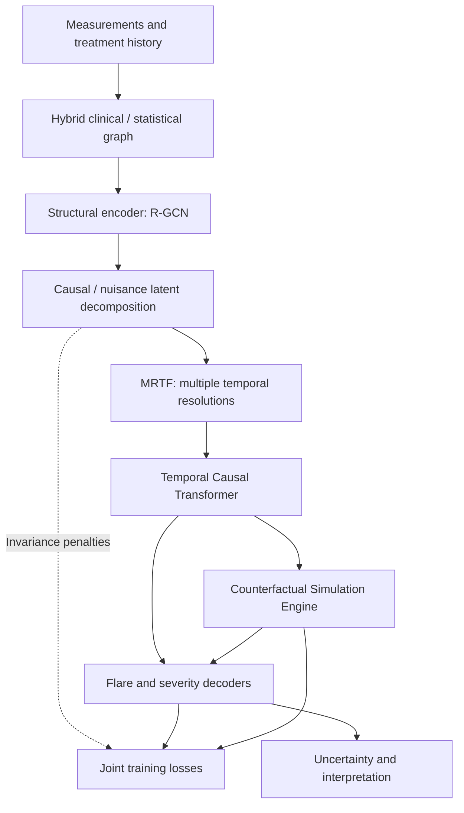
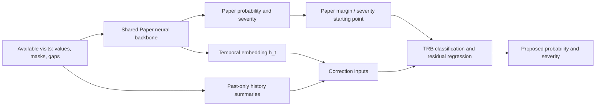

# Methodology: the paper and our proposed framework

The active project compares exactly **two methods**: our local **Paper framework** and the **Proposed framework**, which adds Temporal Residual Boosting (TRB) to the same fitted neural network. This document replaces the earlier Stage I and LECG methodology.

See [Architecture](CAUSAL_MODEL.md) for implementation details, [Measured results](MEASURED_RESULTS.md) for all scores and [the architecture sheet](architecture_sheet.html) for a compact visual.

## 1. What the original paper does

**Sharma and Kaur (2025), _Causal Representation Learning for Predicting Autoimmune Disease Progression From Longitudinal Multimodal Clinical Data_, IEEE Access 13, 150010-150027.** [DOI](https://doi.org/10.1109/ACCESS.2025.3598276) · [supplied PDF](paper/reference.pdf).

The paper predicts a flare and disease severity at the following clinical visit for patients with systemic lupus erythematosus (SLE) or rheumatoid arthritis (RA). It combines treatment, laboratory and other structured clinical histories, aiming to model temporal relationships while reducing sensitivity to observational confounding.

For history available through visit `t`, the two prediction tasks are:

$$\widehat p_{t+1}=f_\theta(X_{1:t},A_{1:t}),\qquad
\widehat s_{t+1}=f^{\mathrm{sev}}_\theta(X_{1:t},A_{1:t}).$$

`X` denotes measurements, `A` treatment information, `p` flare probability and `s` severity. Future outcomes are supervision, not inputs. See Section III.A, equations 1-2, PDF page 5.

The authors report 2,000 clinical patients, approximately 33,100 visits, 54 feature dimensions and a 70% / 15% / 15% split (IV.A, PDF page 13). These are the publication's cohort characteristics; our simulated records are not the authors' original patient data.

## 2. Paper architecture and training methodology



| Paper component | Role | PDF source |
|---|---|---|
| Hybrid causal graph | Combine expert priors with conditional-independence testing to define directed variable relationships. | III.C, equations 3-4, page 6 |
| R-GCN structural encoder | Learn a visit representation with relation-specific messages between clinical / treatment nodes. | III.D, equations 5-6, pages 6-7 |
| Counterfactual Simulation Engine (CSE) | Infer latent noise from factual history and simulate an alternative treatment through the assumed structural model. | III.E, equations 7-9, pages 7-8 |
| Temporal Causal Transformer (TCT) | Use masked attention, time gaps and treatment-aware gates to model earlier visits. | III.F, equations 10-12, page 8 |
| Multi-Resolution Temporal Fusion (MRTF) | Combine short- and long-window representations using learned gates. | III.G, equations 13-15, pages 8-9 |
| Causal Disentanglement and Invariance (CDI) | Separate intended stable / nuisance factors using HSIC dependence and MMD subgroup penalties. | III.H, equations 16-19, pages 9-10 |
| Uncertainty / interpretation | MC dropout, Gaussian-mixture severity, attributions, attention and counterfactual examples. | III.I-J, equations 20-26, pages 10-11 |

The graph-fusion rule is `G = lambda * G_prior + (1-lambda) * G_stat`. The R-GCN uses this structure to encode relationships. MRTF supplies several temporal resolutions; the TCT then learns which earlier visits influence the next prediction. Auxiliary modules are parts of the architecture, not additional comparison models.

The publication combines variational / reconstruction learning, total correlation, counterfactual consistency, focal classification loss and contrastive trajectory learning:

$$\mathcal L=\mathcal L_{ELBO}+\lambda_{TC}\mathcal L_{TC}
+\lambda_{CF}\mathcal L_{CF}+\lambda_{FL}\mathcal L_{FL}+\lambda_{CT}\mathcal L_{CT}.$$

See equation 32 and Algorithm 1, PDF pages 12-13; CDI is additionally described in III.H. The paper specifies Adam, initial learning rate `1e-4`, batch size `64` and validation early stopping. Our 30-epoch cap is a project default, not an established exact paper training schedule.

The paper's preprocessing descriptions differ: III.A discusses GRU-D and timeline alignment / resampling, while IV.A describes carry-forward plus domain imputation and within-patient min-max normalization. Our implementation choices are therefore explicit, rather than described as an exact reconstruction of an unavailable original pipeline.

### Published performance

Tables 2-3 and IV.F report AUROC `0.867`, AUPRC `0.726`, F1 `0.702`, severity MAE `0.74`, RMSE `0.95`, and ECE `0.032` (PDF pages 14-15). These are the authors' results on their own clinical cohort, not scores generated by our code. We cannot establish superiority over `0.867` without access to that original cohort and a matched evaluation.

The publication calls its own model “Proposed Framework.” In this project, **Paper framework** means our implementation of that design, while **Proposed framework** means our TRB extension. These names must be distinguished when reading the original table images.

## 3. Our local Paper framework

[`pair.fit_candidate()`](../src/project/pair.py) explicitly uses `CausalCfg(use_lecg=False)`. Both compared methods share this fitted backbone.

- The fixed relation graph uses a clinical prior and **training-only** partial-correlation statistics, rather than a full PC / kernel-HSIC discovery procedure.
- Two R-GCN layers encode values, observation masks and a latent node; a direct input skip path is also present.
- The visit code is split into 32 intended causal and 16 nuisance dimensions. The naming is an objective, not proof of identified causal factors.
- MRTF uses windows of **1, 3 and 6 visits**, not daily / weekly / monthly resampling.
- A two-layer, four-head TCT produces 64-dimensional temporal embeddings. Its mask is lower-triangular plus padding; it does not implement a full DAG-path attention mask.
- The factual network has a latent-noise / treatment-action path, a flare head and a three-component Gaussian-mixture severity head.
- Losses approximate the paper: TC uses off-diagonal correlation; consistency compares sampled- and mean-noise factual predictions, not verified real intervention effects.
- Paired evaluation uses deterministic `model.eval()` / `sample_noise=False` predictions and validation-fitted Platt scaling. It does not use MC-dropout intervals.

These shared adaptations are not the difference credited to TRB. [CAUSAL_MODEL.md](CAUSAL_MODEL.md) documents shapes, losses and source files.

## 4. The new implementation: Temporal Residual Boosting

### Motivation and architectural influence

The neural network compresses an irregular, partially observed history into a temporal embedding. With limited patients, recent measurements, missingness or longer trends may remain insufficiently expressed in the final prediction. TRB gives a nonlinear correction explicit access to those signals while retaining the neural prediction as its starting point.



**Added:** one prediction stage, engineered history inputs and a second training stage. **Shared:** preprocessing, graph, R-GCN, MRTF, TCT, neural weights, patient split and neural seed. LECG is disabled in both methods; the extension does not change graph edges.

### Correction inputs

[`history_features()`](../src/project/improvement.py) forms nine groups per clinical variable:

| Group | Available information |
|---|---|
| Current normalized values | Current measurements; missing values zero-filled after scaling. |
| Observation mask | Whether each measurement was observed. |
| Running observed mean | Average of available values through the current visit. |
| Recent exponential history | Forward-only summary with weight 0.5 for a newly observed value. |
| Previous-visit difference | Change from the preceding scaled visit representation. |
| Last-three-visit mean | Observed-value mean over up to three recent visits. |
| Last-observed change | Difference from the most recent available measurement. |
| Change rate | Last-observed change divided by elapsed 30-day gap units, with denominator at least one. |
| Observation age | `log1p` of gap units elapsed since that variable was observed. |

One transformed time gap and the 64-dimensional temporal embedding are also included. The vector has `9V + 65` dimensions: **326** for 29 public-cohort inputs, **533** for 52 main-simulation inputs and **227** for 18 random-cohort inputs. This is an engineered-vector size, not a count of independent measurements. Patient IDs and future-outcome columns are not inputs.

### Flare: correction in logit space

Let `p_P` be the calibrated Paper probability, `ell_P = logit(p_P)`, and `F(q_t; ell_P)` the classifier's corrected margin. XGBoost is fitted with `ell_P` as `base_margin`. The final probability is:

$$\widehat p_{proposed}=\sigma\left(\ell_P+\alpha\,[F(q_t;\ell_P)-\ell_P]\right).$$

The classifier learns through the boosting objective with an offset; it is not a separate regression on `label - probability`. Validation selects `alpha` from `{0, 0.25, 0.5, 0.75, 1}`. Zero correction remains available if the added head does not improve validation ranking.

### Severity: regression on prediction residuals

The regressor learns `actual severity - s_P`, where `s_P` is the raw Paper mixture mean:

$$\widehat s_{proposed}=\operatorname{clip}_{[0,4]}\left(s_P+\beta R(q_t)\right).$$

Validation selects `beta` from the same strengths using MAE. Classification and severity can choose different configurations and strengths.

### The changed training methodology

1. Fit the shared neural backbone on training patients, stopping on validation loss.
2. Freeze it and extract deterministic training / validation predictions and embeddings.
3. Fit correction heads on training-patient targets; classification uses the Paper margin, regression its severity residual.
4. Select tree stopping points, configurations and strengths using validation patients only.
5. Freeze both methods and score identical held-out patients.

This turns a single neural predictor into a **neural-plus-boosting predictor fitted in two stages**. Gradients do not pass back from trees into the network. XGBoost is an established algorithm; our contribution is this architecture / history integration and evaluation, not invention of boosting.

The fixed internal search uses depth / minimum-child-weight / L2 settings `(2,12,20)`, `(3,8,10)` and `(4,8,15)`. The last considers patient-balanced weights. Heads allow up to 300 trees at learning rate `0.03`, with 25-round early stopping. Classification ranks validation AUROC, then AUPRC, then negative Brier; severity uses validation MAE. These are configurations inside one framework, not additional methods.

## 5. Datasets, targets and preprocessing

| Dataset | Role | Patient split |
|---|---|---|
| GSE65391 public SLE | 157 patients, 923 visits, 29 treatment / laboratory / symptom / current-SLEDAI inputs. Genomics are not used here. | 109 train / 24 validation / 24 test |
| Main simulated SLE / RA | 2,000 generated patients, 52 input variables; the legacy “54-dim” name also counts two outcomes. Not the authors' clinical records. | 1,400 / 300 / 300 |
| Three random stress tests | Each has 120 generated patients, six visits, 18 inputs and 20% added graph edges. | 72 / 24 / 24 each |

Public-data flare is the proxy `SLEDAI(t+1) - SLEDAI(t) >= 4`. Next severity uses bins **0, 1-5, 6-10, 11-19, >=20**, mapped to categories 0-4. These are project definitions, not the paper's exact original labeling protocol. Simulations use their generated next-visit targets.

Histories retain recorded order. Selected skewed measurements are log-transformed and standardized using training-patient statistics; treatments retain source coding. Missing values are zero-filled after transformation and accompanied by masks. Time gaps enter as `log1p(gap_days / 30)`. Future extrema, held-out measurements and future targets do not fit scaling.

A final visit without a following outcome is excluded from supervised scores. Uploaded records can still receive a prediction there; unknown outcomes remain unscored.

## 6. Evaluation and reproducibility

Both methods share patient splits and neural weights. Defaults are maximum 30 epochs, batch size 64, learning rate `1e-4`, patience six, and dataset / split seed 42.

A one-time validation search considered neural seeds **7, 21, 42, 73, 123**. Proposed validation AUROC selected **73**, with AUPRC, Brier and severity MAE tie breakers. It is frozen in `config/frozen_seed.json`; ordinary launches and `--update` reuse it. Test scores do not select the seed.

Paper probabilities receive validation-fitted Platt scaling. Each framework's Yes/No threshold maximizes validation F1 over a fixed grid, then stays fixed for test / uploaded outcomes. Paired metrics are AUROC, AUPRC, F1, severity MAE / RMSE, Brier and ECE.

The AUROC-change interval uses 500 paired **patient** bootstrap resamples, retaining draws with both classes. It resamples the evaluation patients for fixed fitted models; it excludes retraining, seed-search and population uncertainty.

Validation is reused for checkpoint choice, calibration, head tuning, seed selection and thresholds. Seed selection favors Proposed rather than independently optimizing Paper. Results are conditional on this exploratory selection, not a comparison to the best possible paper implementation. Independent or nested grouped validation remains future work.

## 7. How much did it improve?

This block is regenerated from completed runs alongside the README. Full metrics, including unfavorable changes, and source hashes appear in [MEASURED_RESULTS.md](MEASURED_RESULTS.md).

<!-- RUN_RESULTS:START -->

Generated from the latest completed run. Retraining updates this section automatically.

Frozen model seed: **73**. Patient split seed: **42**. Maximum neural epochs: **30**.

| Evaluation cohort | Paper framework AUROC | Proposed framework AUROC | Change |
|---|---:|---:|---:|
| Public pediatric SLE cohort, GSE65391 | 0.5203 | 0.7201 | +19.98 points |
| Simulated SLE / RA cohort | 0.5885 | 0.6544 | +6.59 points |

Public SLE holdout: AUPRC **0.1744 → 0.3637**, F1 **0.2817 → 0.3438**, severity MAE **0.826 → 0.586**.

Public pediatric SLE cohort, GSE65391: **24 held-out patients**; paired patient bootstrap 95% interval for AUROC change: **-0.55 to +41.25 points**.

Simulated SLE / RA cohort: **300 held-out patients**; paired patient bootstrap 95% interval for AUROC change: **+4.69 to +8.51 points**.

The seed was chosen using validation scores, not test scores. These are exploratory local comparisons; performance can vary across datasets and the original paper cohort is unavailable.

<!-- RUN_RESULTS:END -->

An AUROC increase of `0.04` is **4 percentage points**, different from a 4% relative increase. Relative error reduction is `(Paper error - Proposed error) / Paper error * 100`.

The observed gains do not guarantee 4-5 points on every dataset. Inspect the generated result tables for calibration and F1 trade-offs as well as AUROC. Better ranking does not imply every metric or individual prediction improves.

## 8. What can be claimed

The project implements a paper-inspired graph / temporal backbone and one past-only, missingness-aware residual correction. Stored holdouts show gains in several predictive metrics against that shared local backbone. The workflow also supplies paired evaluation, actual-data / uploaded-outcome checking and cached visualizations.

It does not establish superiority on the authors' unavailable cohort, universal gains, clinical validity, a new boosting algorithm, or identified treatment effects. A t-SNE / PCA cluster or treatment perturbation is not proof of causality. Neural explanations and uncertainty measures do not automatically cover the tree correction.

## 9. Reproduce and read further

```shell
uv sync --locked
uv run python run.py --check-device
uv run python run.py
```

`--prepare-only` prepares without the UI; `--update` rebuilds with the frozen seed. Completed runs are hash-verified and reused. Training refreshes the generated result documents; the source-paper graphics remain fixed historical references.

- [Architecture](CAUSAL_MODEL.md)
- [All measured gains and limitations](MEASURED_RESULTS.md)
- [Current implementation audit](PROJECT_AUDIT.md)
- [Installation and app instructions](../README.md)

*Academic research prototype. Causal terminology describes paper and model assumptions; these comparisons evaluate prediction.*
